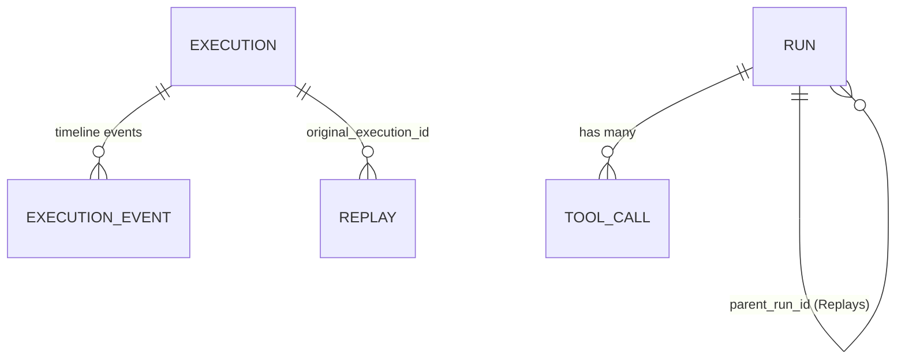
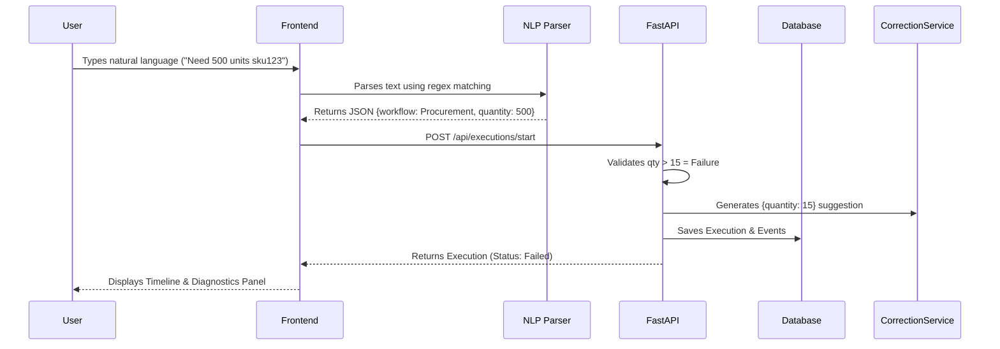

# AgentReplay Architecture Documentation

## 1. System Overview

AgentReplay is an MVP observability and debugging platform built explicitly for AI agent developers. It acts as "DevTools for AI agents," providing a centralized dashboard to monitor deterministic execution workflows, identify complex operational failures (like hallucinations, context limits, and malformed outputs), and trigger deterministic payload corrections via a robust Replay engine.

The platform is designed around the core principle that **Replay is not merely a rerun button**. Instead, it is an active diagnostic tool that surfaces errors, provides actionable payload patches, and generates a side-by-side comparative diff of the failed state versus the corrected state.

The application adheres to a strict monorepo layout avoiding over-engineered enterprise patterns (no Redis, Celery, or Kafka instances). Everything is orchestrated to run deterministically and immediately via local Docker compose.

## 2. Frontend Architecture

The frontend is a server-side rendered (SSR) React application utilizing the **Next.js 15 App Router** architecture. 

*   **Language:** TypeScript (Strict)
*   **Styling:** Tailwind CSS + custom CSS variables.
*   **Component Library:** `shadcn/ui` (Radix Primitives).
*   **State Management:** Built-in React Hooks (`useState`, `useTransition`) combined with URL query parameters for persistent searching/filtering.
*   **Data Fetching:** Direct server-side `fetch()` operations executing against the internal Docker API gateway. Client-side mutations utilize Next.js Server Actions.

### Key Directories
*   `apps/frontend/src/app/page.tsx`: The primary Dashboard table and search/filter hub.
*   `apps/frontend/src/app/runs/[id]`: Detailed view for external Agent SDK runs.
*   `apps/frontend/src/app/playground`: The interactive deterministic workflow simulator.
*   `apps/frontend/src/components/agent-run/`: Domain-specific components handling Lineage, RCA diagnostics, and Comparisons.

## 3. Backend Architecture

The backend is a synchronous, high-performance REST API driven by **FastAPI**.

*   **Language:** Python 3.12
*   **Web Framework:** FastAPI
*   **Server:** Uvicorn
*   **Database ORM:** SQLAlchemy
*   **Validation:** Pydantic models (Schemas)

The backend exposes an OpenAPI-compliant gateway structured cleanly into routers, services, and models. The logic strictly enforces deterministic outcomes. It relies on a local rule-engine (`CorrectionService`) rather than active LLM embeddings to deduce corrections, preserving the MVP timeline.

## 4. Database Models

The persistence layer relies on **PostgreSQL**. The schema is intentionally minimal, designed to capture the lifecycle of AI runs and executions natively.

### 4.1 External Agent Runs
*   **`runs` Table:** Captures metadata generated by the external Python SDK.
    *   `id`, `session_id`, `prompt`, `response`, `model`, `latency_ms`, `tokens_used`, `status`.
    *   *Self-Referential:* `parent_run_id` links Replays back to their original failure.
    *   *Failure Metadata:* `error_type`, `error_message`, `timeout_reason`, `malformed_output`, `token_limit_hit`.
*   **`tool_calls` Table:** Relates `1:N` with `runs` tracking intermediate function calls (e.g., `fetch_customs_status`).

### 4.2 Playground Executions (Sprint 2)
*   **`executions` Table:** Tracks deterministic Playground simulations.
    *   `id`, `workflow_name`, `input_payload`, `status`, `failure_reason`, `diagnostic_explanation`, `suggested_correction`.
*   **`execution_events` Table:** Tracks granular timeline steps for an `execution` (e.g., "Inventory Checked").
*   **`replays` Table:** Maps a successful replay payload back to its original failed `execution`.

## 5. API Endpoints

### Agent SDK Integration
*   `GET /api/runs`: Fetches paginated runs. Accepts `search`, `status`, `model` queries.
*   `POST /api/runs`: Ingests run data from the `python-sdk`.
*   `GET /api/runs/{id}`: Detailed fetch for a single run.
*   `GET /api/runs/{id}/lineage`: Recursively traverses the `parent_run_id` tree up and down to build the history chain.
*   `POST /api/runs/{id}/replay`: Triggers a mock replay of an external SDK run.

### Playground Simulators
*   `POST /api/executions/start`: Accepts a `workflow_name` and `input_payload`. Evaluates payload deterministically against hardcoded rules to generate failures and diagnostics.
*   `GET /api/executions/{id}`: Retrieves state.
*   `POST /api/executions/{id}/replay`: Accepts a corrected payload. Synthesizes a successful `ExecutionEvent` timeline.

## 6. Execution Flow (Playground)

The Playground demonstrates the platform's diagnostic capability without requiring SDK integration.

## 7. Replay Flow

Replay execution is heavily optimized for visibility. Replays do not mutate original data; they append child data.

1.  User observes a failed `Execution` on the Frontend.
2.  Frontend renders the `SuggestedCorrection` component if the backend provided a diagnostic patch.
3.  User clicks "Replay with Suggested Fix".
4.  FastAPI receives the payload and writes a new successful `Replay` relation and a new successful `Execution` object.
5.  Frontend `ReplayComparison.tsx` mounts side-by-side cards explicitly highlighting the delta (e.g., *Latency reduced by 400ms* or *Inventory Check Complete*).

## 8. Current Data Relationships

AgentReplay segregates external SDK Runs (`runs`) from internal simulator Executions (`executions`). 
*   **Lineage** operates natively on `runs` via recursive `parent_run_id` traversal.
*   **Lineage** operates on `executions` using the `replays` bridge table.

## 9. Deployment Architecture

The entire monorepo is containerized for seamless local deployment using Docker Compose.

*   `db`: `postgres:15-alpine` container mounting a volume to `/var/lib/postgresql/data`.
*   `backend`: Alpine Python 3.12 building from `apps/backend/Dockerfile`. Injects `DATABASE_URL` targeting `db:5432`.
*   `frontend`: Node/Alpine building Next.js from `apps/frontend/Dockerfile`. Injects `API_URL=http://backend:8000/api` for internal SSR routing.

## 10. Technical Debt

*   **Search Pagination:** The Dashboard relies on standard offset-pagination but does not enforce maximum cursor limits, susceptible to Deep Pagination performance drops if millions of runs are ingested.
*   **Playground Isolation:** Currently, Playground Execution models share no interfaces with standard Agent SDK Run models. A structural unification (polymorphic relationship) would reduce duplicated Replay/Comparison logic.
*   **Parser Fragility:** The Natural Language Input relies strictly on regex/keyword extraction on the client-side. Edge-case phrases will break validation.
*   **Data Retention:** No TTL or Cron jobs exist to purge ancient telemetry records.

## 11. Future Extension Points

*   **Authentication & Tenant Scoping:** Introduce simple API key injection to partition the database per-organization or per-user.
*   **True SDK Replay:** Expand the Python SDK to accept Webhook callbacks allowing AgentReplay to trigger a live re-execution directly on the host machine.
*   **Dynamic Rule Engine:** Migrate the static `CorrectionService` into a configurable Database table or YAML file allowing organizations to define their own failure traps.
